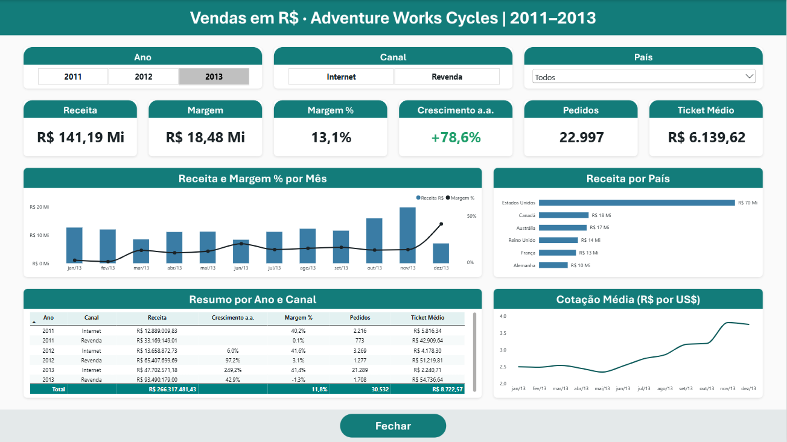

# Vendas AdventureWorks em R$ (2011–2013)

Análise das vendas da AdventureWorks convertidas para reais pela cotação do dia de cada pedido, do SQL Server ao Power BI, com todos os números validados contra o banco.


*Página "Análise" filtrada em 2013.*

## Problema

A base AdventureWorksDW2014 registra as vendas em dólar. A pergunta foi: **como seria a leitura desse negócio para um gestor no Brasil, em R$?** Converter com uma taxa fixa esconde o efeito do câmbio, então cada venda foi convertida pela cotação BRL do dia em que o pedido foi feito.

## Fluxo

```
dados brutos → limpeza → transformação → análise → indicadores → visualização → validação → interpretação
```

| Etapa | O que foi feito |
|---|---|
| Dados brutos | `FactInternetSales`, `FactResellerSales` e a cotação diária `FactCurrencyRate` |
| Transformação (SQL) | Views `view_cotacaobrl` e `view_vendasbrl`: os dois canais numa base só, já em R$, com período 2011–2013 e colunas e valores em português (país, região, continente) |
| Limpeza (Power Query) | Só territórios com venda; a consulta `AnosAnalise` confere que cada ano tem venda nos 12 meses |
| Modelo (Power BI) | Fato `vendas` ligado a `data`, `produtos`, `clientes`, `revendas` e `territorios` |
| Indicadores (DAX) | 14 medidas: base, inteligência de tempo e textos/cores para formatação condicional |
| Visualização | Capa + página "Análise": filtros de Ano, Canal e País; 6 cartões; receita × margem por mês; receita por país; resumo por ano e canal; evolução da cotação |
| Validação | Cada número do dashboard conferido com uma consulta SQL independente, até o centavo |

## Decisões e regras de negócio

- **Conversão pela cotação do dia do pedido.** Na `FactCurrencyRate`, `AverageRate` é quantos dólares vale 1 real; por isso `R$ = USD / AverageRate`.
- **Recorte 2011–2013 na própria view.** A base tem 2010 com poucos dias de venda e 2014 só com janeiro; a view filtra de 01/01/2011 a 31/12/2013 (anos civis completos).
- **Revenda sem dezembro/2013.** A última venda da Revenda na base é de 29/11/2013. A Internet tem os 36 meses; a nota aparece no relatório.
- **Crescimento só entre anos inteiros.** O `Crescimento % a.a.` fica em branco quando o período atual ou o do ano anterior não está completo na base (por isso 2011 aparece como "s/ comparação").
- **Um ano por vez.** O filtro de Ano é de seleção única (abre em 2013), para os gráficos mensais nunca somarem anos diferentes; a tabela "Resumo por Ano e Canal" ignora esse filtro e mostra os três anos lado a lado.
- **Tudo em português na origem.** País, região e continente chegam traduzidos da view (`CASE` no SQL).
- **Cotação média ponderada pela receita**: `Receita R$ / Receita USD`, e não a média simples das cotações.

## Indicadores

| Pasta | Medidas |
|---|---|
| 1 Base | Receita R$, Custo R$, Margem R$, Margem %, Qtd Vendida, Pedidos, Ticket Médio R$, Cotação Média |
| 2 Tempo | Receita R$ YTD, Receita R$ Ano Anterior, Crescimento % a.a. |
| 3 Textos e Cores | Txt Crescimento, Cor Crescimento, Cor Margem |

## Resultados (2011–2013)

| Indicador | Valor |
|---|---|
| Receita | R$ 266.317.481,43 |
| Margem | R$ 31.398.923,67 (11,8%) |
| Pedidos | 30.532 |
| Ticket médio | R$ 8.722,57 |
| Quantidade vendida | 271.972 |
| Cotação média (BRL/USD) | 2,44 |
| Crescimento da receita | +71,7% em 2012 · +78,6% em 2013 |

Validação: 118.917 linhas; receita, margem, pedidos e ticket batem com o SQL no total, por ano/canal e por país.

## Principais achados

1. **Cerca de metade do crescimento em R$ veio do câmbio.** Em dólar, a receita cresceu cerca de +35% em 2012 e +47% em 2013; em reais, +72% e +79%. Quem olha só o número em R$ superestima o desempenho comercial.
2. **A margem da Revenda fica perto de zero e chega a ser negativa.** O lucro vem quase todo do canal Internet. Isso está na origem dos dados, não é efeito da conversão.
3. **O ticket da Internet caiu em 2013**, sinal de mudança no mix de produtos vendidos.

### Próximas perguntas

- Por que a margem da Revenda ficou negativa em 2013? (olhar por produto e por promoção, `DimPromotion`)
- Que categorias de produto explicam a queda do ticket na Internet em 2013?

## Estrutura do repositório

```
views_cotacaobrl_vendasbrl.sql                     views no SQL Server + consultas de conferência
vendas_brl_adventureworks_2011_2013.pbip           projeto do Power BI (abrir este arquivo)
vendas_brl_adventureworks_2011_2013.SemanticModel/ modelo em TMDL: tabelas, relacionamentos, medidas DAX, Power Query
vendas_brl_adventureworks_2011_2013.Report/        capa e página "Análise" em PBIR (JSON)
background.pptx                                    telas de fundo da capa e da página Análise
gerar_pagina_vendas_brl.py                         script que gerou a primeira versão da página (histórico)
docs/dashboard.png                                 print da página Análise
```

## Como reproduzir

1. Restaure o banco **AdventureWorksDW2014** num SQL Server.
2. Rode `views_cotacaobrl_vendasbrl.sql` para criar as views `dbo.view_cotacaobrl` e `dbo.view_vendasbrl`.
3. Abra `vendas_brl_adventureworks_2011_2013.pbip` no Power BI Desktop.
4. As consultas apontam para o SQL Server local do autor. Troque pelo nome do seu servidor em **Transformar dados → Configurações da fonte de dados** e atualize.

## Ferramentas

SQL Server (T-SQL, views) · Power BI Desktop (Power Query M, DAX, formato PBIP/TMDL/PBIR) · PowerPoint (telas de fundo) · Python · IA (Claude) como apoio na construção e na validação
